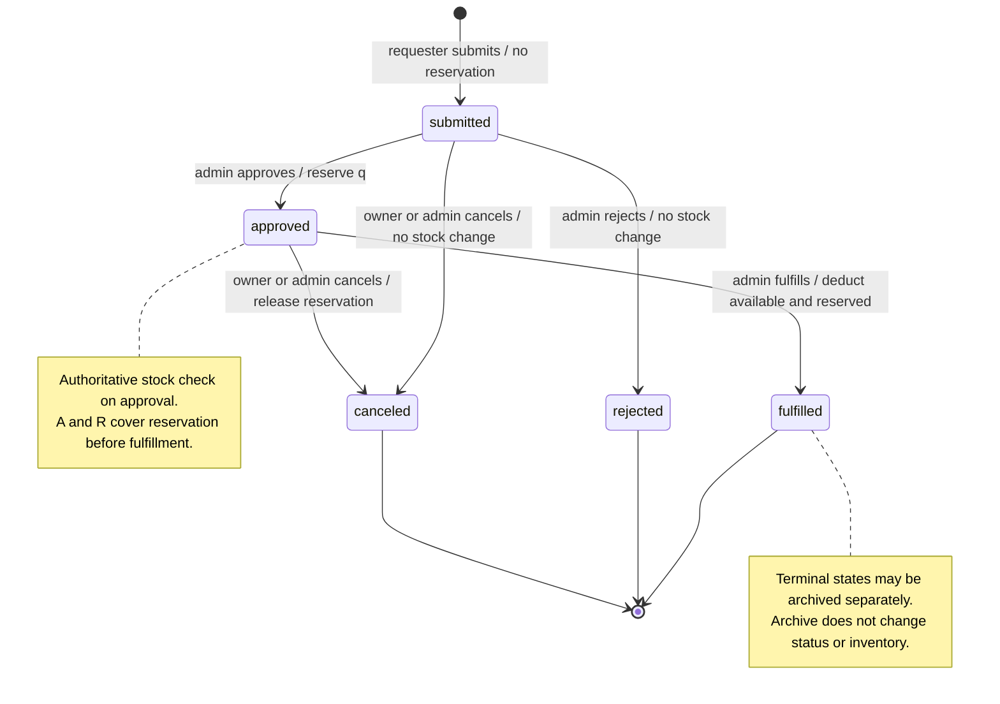

# Order state machine

Status: verified against source; core normal and exception paths have local HTTP
evidence. Other transitions are source-reviewed; mentor acceptance is pending.
Source: `src/order/service.py`, `src/order/router.py`, `src/order/schemas.py`, and
migration `20260812_0003`. See [evidence](step-00-evidence.md).

## States and transitions

Let A = material quantity_available, R = material quantity_reserved,
U = A − R, q = requested_quantity, and r = order reserved_quantity.
All five stored statuses are `submitted`, `approved`, `rejected`, `fulfilled`,
and `canceled`. Archive is a flag, not a sixth status.

| From → to | Action | Actor | Preconditions | Inventory / order effect | Inventory audit |
| --- | --- | --- | --- | --- | --- |
| No order → submitted | `POST /orders` | Viewer/staff/admin | Positive q; existing active material; U ≥ q | A/R unchanged; r=0; owner=current user | None |
| Submitted → approved | `/approve` | Admin | Active material; U ≥ q under locks | R+=q; A unchanged; r=q | `order_reservation_created` |
| Submitted → rejected | `/reject` | Admin | Submitted status | A/R unchanged; r=0 | None |
| Submitted → canceled | `/cancel` | Owner or admin | Submitted status | A/R unchanged; r=0; no material check | None |
| Approved → fulfilled | `/fulfill` | Admin | Active material; A ≥ r and R ≥ r | A-=r; R-=r; r=0 | `order_fulfilled` |
| Approved → canceled | `/cancel` | Owner or admin | Material exists; R ≥ r | R-=r; A unchanged; r=0 | `order_reservation_released` |

Each review/cancel operation records the actor in `reviewed_by_user_id`, updates
`reviewed_at`, and writes supplied `outcome_notes` (or null). A cancellation can
therefore replace the previous approval reviewer metadata. Audit entries retain
individual inventory-transition actors and reasons.

No other status transitions exist. In particular, approved → rejected,
submitted → fulfilled, terminal → active, and duplicate fulfillment are forbidden.

## Archive lifecycle

For fulfilled/rejected/canceled orders, owner or admin may call
`POST /orders/{id}/archive` with `{reason: nonblank string}`. It sets
`is_archived`, actor, timestamp, reason and writes `order_archived` with identical
before/after inventory snapshots. Status and A/R remain unchanged. Active orders
cannot be archived; duplicate archive returns `409 ORDER_ALREADY_ARCHIVED`.
There is no order-unarchive route. Default list hides archived orders, while
`include_archived=true` and direct owner/admin reads expose them.

## Failure behavior

- Missing/invalid authentication: `401`; no order action runs.
- Viewer/staff approval, rejection, fulfillment: `403 PERMISSION_DENIED`.
- Missing order or inaccessible owner-scoped order: `404 ORDER_NOT_FOUND`.
- Wrong source state: `409 ORDER_STATUS_CONFLICT`.
- Submission/approval stock shortage: `409 ORDER_STOCK_INSUFFICIENT`.
  Failed submission creates no order; failed approval leaves it submitted.
- Archived material blocks submission, approval, fulfillment with
  `409 MATERIAL_ARCHIVED`. Approved-order cancellation intentionally remains
  available for recovery of a legacy archived-material reservation.
- Fulfillment with insufficient available/reserved backing or cancellation with
  insufficient material reservation: `409 ORDER_RESERVATION_INCONSISTENT`.
- Malformed input: `422 VALIDATION_ERROR`.
- Audit-write failure prevents an inventory transition from committing. Source
  tests cover rollback and concurrent approve/fulfill/cancel races; their execution
  status is recorded separately in the evidence report.

Checks occur before business updates; order and material locks protect relevant
stock transitions, and the inventory audit is in the same transaction. After an
unexpected error or lost connection, reconcile through GETs before retrying.

## Verified fixture walkthrough (orders 1 and 3)

| Stage | Order status | A | R | U | Order r |
| --- | --- | --- | --- | --- | --- |
| Material created | None | 100 | 0 | 100 | — |
| Request 20 submitted | submitted | 100 | 0 | 100 | 0 |
| Request 20 approved | approved | 100 | 20 | 80 | 20 |
| Request 20 fulfilled | fulfilled | 80 | 0 | 80 | 0 |
| Separate request 10 submitted | submitted | 80 | 0 | 80 | 0 |
| Request 10 approved | approved | 80 | 10 | 70 | 10 |
| Request 10 canceled by owner | canceled | 80 | 0 | 80 | 0 |

For minimum quantity 20, availability remains `available` at these stages.
`qc_status=passed` remains unchanged. Rejection never releases an approved
reservation because approved orders are not eligible for rejection.
